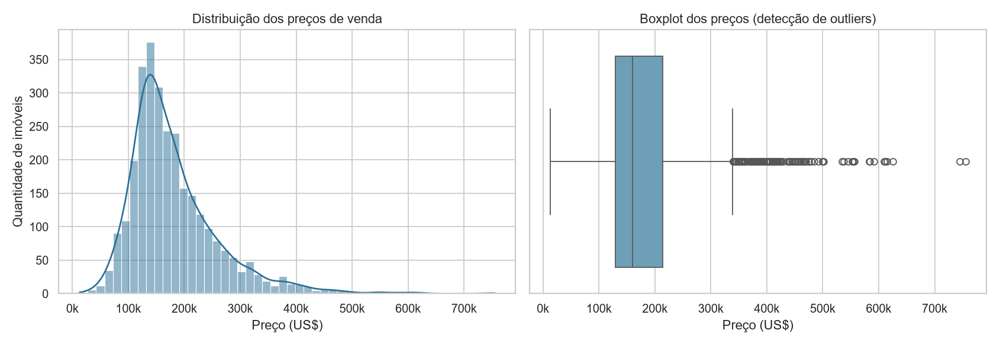
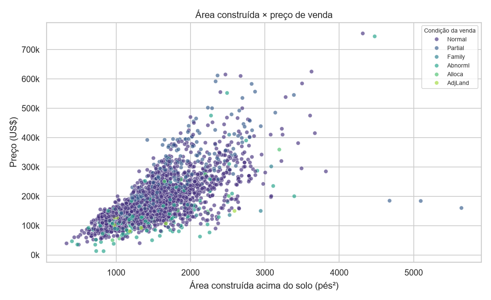
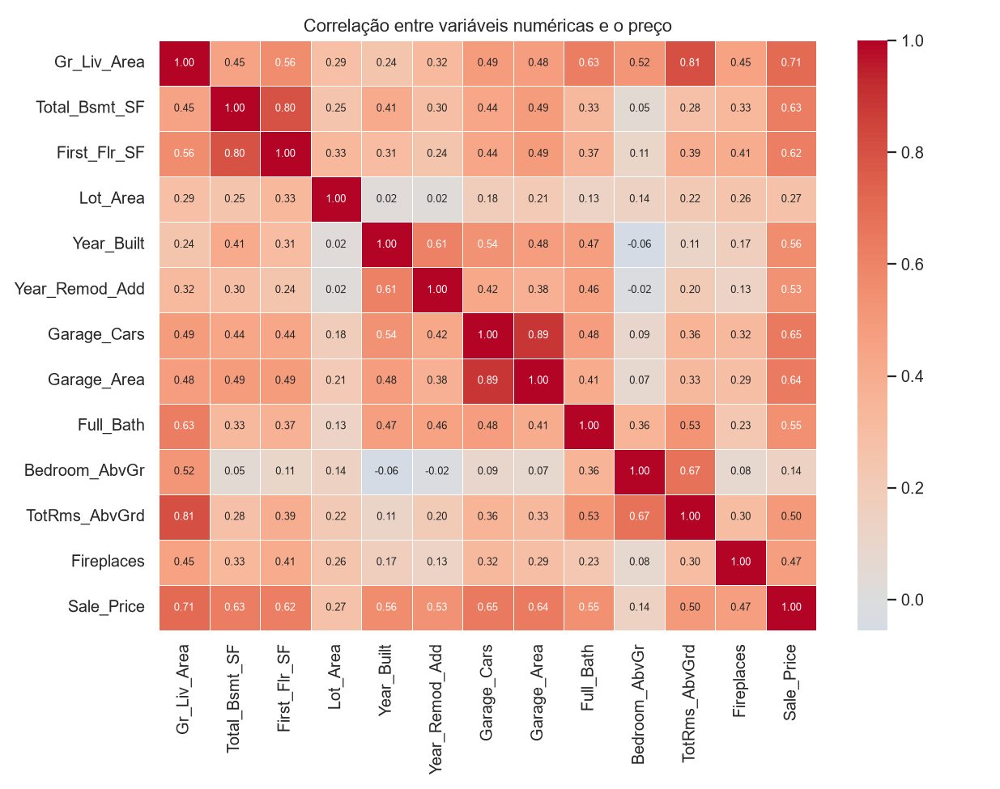
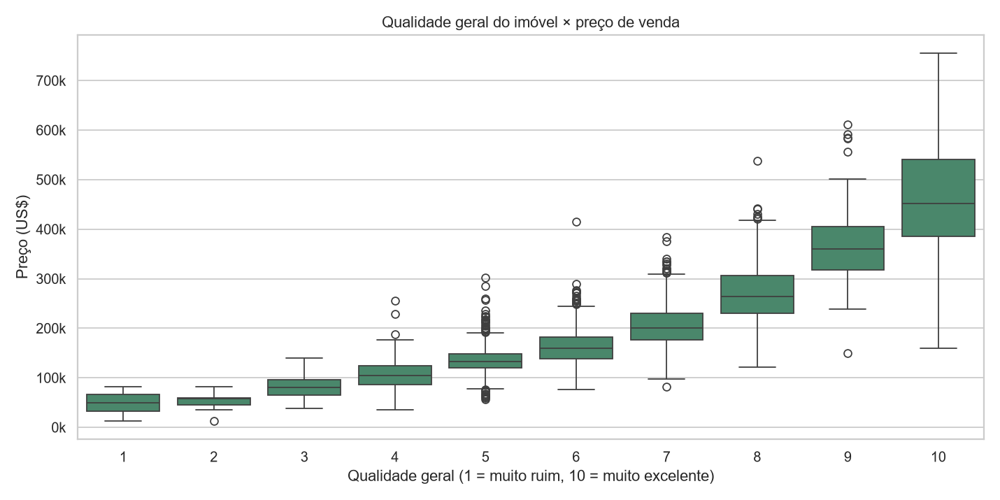
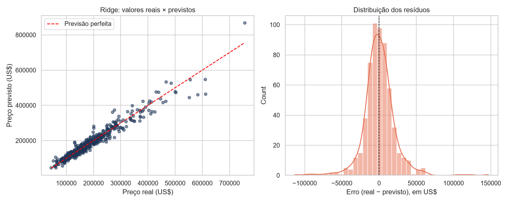
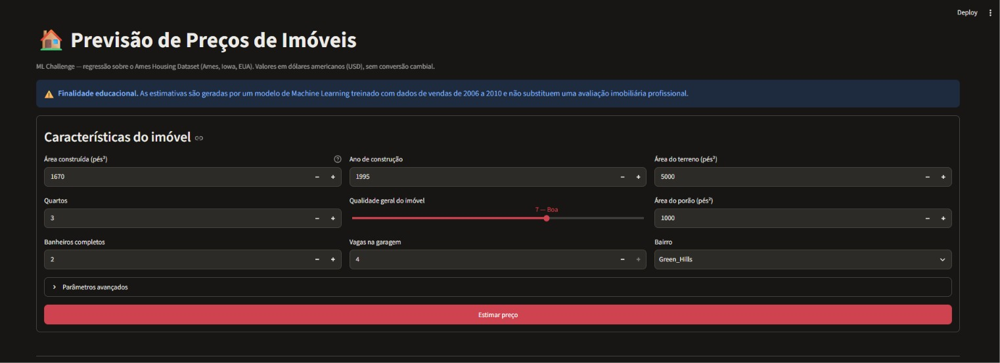
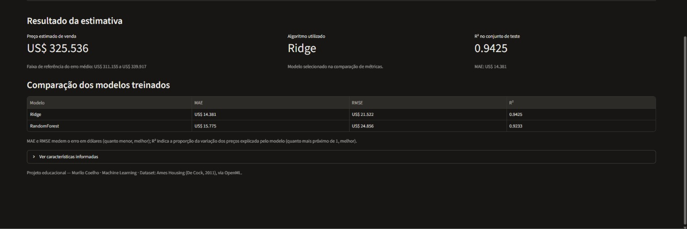

# 🏠 Previsão de Preços de Imóveis — ML Challenge

Aplicação de Machine Learning que estima o preço de venda de imóveis a partir de suas
características, usando o **Ames Housing Dataset** e uma interface interativa em
**Streamlit**.

**Estudante:** Murilo Coelho
**Área:** Análise e Desenvolvimento de Sistemas
**Disciplina:** Machine Learning
**Tipo de projeto:** Regressão
**Linguagem:** Python 3.12

---

## 1. Sobre o projeto

Este projeto aplica técnicas de Ciência de Dados e Inteligência Artificial para estimar o
preço de venda de imóveis. A partir de características como área construída, número de
quartos, qualidade geral, ano de construção e bairro, o modelo aprende padrões em um
histórico real de vendas e devolve uma estimativa de valor.

O problema é de **regressão supervisionada**: a variável-alvo (`Sale_Price`) é contínua e
o objetivo é minimizar o erro entre o preço previsto e o preço real de venda.

A entrega final é uma aplicação Streamlit em que qualquer pessoa informa as
características de um imóvel e recebe a estimativa gerada pelo modelo treinado, além de
conhecer o algoritmo utilizado e as métricas de desempenho.

> **Aviso:** projeto de finalidade educacional e demonstrativa. As estimativas não
> substituem uma avaliação imobiliária profissional.

## 2. Dataset

| Item | Informação |
|---|---|
| **Base** | Ames Housing Dataset |
| **Autor original** | Dean De Cock (2011) |
| **Fonte utilizada** | [OpenML — `data_id=41211`](https://www.openml.org/d/41211) |
| **Licença** | *Public* — uso livre para fins educacionais e de pesquisa |
| **Registros** | 2.930 imóveis (2.927 após limpeza) |
| **Variáveis** | 80 atributos + `Sale_Price` |
| **Localidade / período** | Ames, Iowa (EUA) — vendas entre 2006 e 2010 |
| **Moeda** | Dólar americano (USD), sem conversão cambial |

**Citação:**

> De Cock, D. (2011). Ames, Iowa: Alternative to the Boston Housing Data as an End of
> Semester Regression Project. *Journal of Statistics Education*, 19(3).

O dicionário completo das variáveis, as particularidades da versão do OpenML e as
inconsistências encontradas estão documentados em [`data/README.md`](data/README.md).
O CSV é baixado automaticamente na primeira execução e fica versionado no repositório
para que o projeto funcione offline.

## 3. Tecnologias

| Tecnologia | Finalidade |
|---|---|
| Python 3.12 | Desenvolvimento |
| Pandas | Manipulação de dados |
| NumPy | Operações numéricas e transformação logarítmica |
| Scikit-learn | Pré-processamento, modelos e métricas |
| Matplotlib / Seaborn | Análise visual |
| Joblib | Serialização do modelo |
| Streamlit | Interface interativa |
| Git / GitHub | Versionamento e publicação |

## 4. Estrutura do projeto

```text
ml-challenge-imoveis/
│
├── app.py                  # aplicação Streamlit
├── train.py                # EDA, treino, avaliação e salvamento
├── requirements.txt
├── README.md
├── .gitignore
│
├── data/
│   ├── README.md           # documentação e dicionário do dataset
│   └── ames_housing.csv
│
├── models/
│   └── model.joblib        # pipeline completo + metadados
│
├── reports/
│   ├── metricas.json
│   └── graficos/
│       ├── 01_distribuicao_preco.png
│       ├── 02_area_vs_preco.png
│       ├── 03_mapa_correlacao.png
│       ├── 04_qualidade_vs_preco.png
│       └── 05_real_vs_previsto.png
│
└── screenshots/
    ├── interface.png
    └── resultado.png
```

## 5. Análise exploratória

### Distribuição dos preços



### Área construída × preço



### Correlação entre as variáveis



### Qualidade geral × preço



### Conclusões objetivas

1. **O preço é assimétrico à direita** (assimetria = 1,74): média de US$ 180.796,06
   contra mediana de US$ 160.000,00. Existe uma cauda de imóveis de alto valor que
   puxa a média para cima — por isso o treinamento usa `log1p` no alvo.
2. **O porte do imóvel é o principal sinal de valor:** as maiores correlações com o
   preço são `Gr_Liv_Area` (0,71) e `Garage_Cars` (0,65), seguidas por
   `Garage_Area` (0,64) e `Total_Bsmt_SF` (0,63).
3. **Qualidade geral tem efeito multiplicativo:** imóveis com qualidade máxima valem
   cerca de **9,2×** mais que os de qualidade mínima (US$ 450.217,32 contra
   US$ 48.725,00). A relação é monotônica e forte.
4. **Três registros são inconsistentes:** vendas marcadas como `Partial` de imóveis com
   mais de 4.000 pés², com preço muito abaixo do mercado. Foram removidos antes do
   treinamento.

## 6. Pré-processamento

- **Seleção de variáveis:** 23 atributos (14 numéricos e 9 categóricos), escolhidos por
  relevância e por serem viáveis de preencher em um formulário.
- **Limpeza:** remoção de duplicatas (nenhuma encontrada) e das 3 vendas parciais
  atípicas.
- **Variáveis ordinais:** `Overall_Qual` e `Overall_Cond` vêm como texto nesta versão do
  OpenML e são convertidas para a escala 1–10.
- **Pipeline + ColumnTransformer:**
  - numéricas → `SimpleImputer(median)` + `StandardScaler`;
  - categóricas → `SimpleImputer("constante")` + `OneHotEncoder(handle_unknown="ignore")`.
- **Divisão:** 80% treino (2.341 registros) e 20% teste (586 registros),
  `random_state=42`.
- **Prevenção de data leakage:** todas as transformações estão dentro do `Pipeline`,
  portanto são ajustadas **apenas** com os dados de treinamento.

## 7. Modelos e resultados

Dois algoritmos de regressão foram treinados com `GridSearchCV` e validação cruzada
(`KFold`, 5 folds), ambos com o alvo transformado por `log1p` e revertido com `expm1`
na previsão:

| Modelo | Configuração escolhida | MAE | RMSE | R² |
|---|---|---|---|---|
| **Ridge** (escolhido) | `alpha=0.1` | **US$ 14.381,14** | **US$ 21.521,78** | **0,9425** |
| Random Forest | `max_depth=20`, `min_samples_leaf=2`, 300 árvores | US$ 15.774,52 | US$ 24.855,73 | 0,9233 |

*Métricas calculadas no conjunto de teste (586 imóveis nunca vistos no treino).*

### Valores reais × previstos (modelo escolhido)



### Justificativa do modelo escolhido

O **Ridge** apresentou o menor RMSE (US$ 21.521,78) e o maior R² (0,9425), superando o
Random Forest em todas as métricas. Apesar de o Random Forest capturar relações não
lineares, o modelo linear regularizado generalizou melhor com o volume de dados
disponível, sem o sobreajuste típico de florestas em bases desse tamanho. Como o
objetivo inclui interpretabilidade e a diferença de desempenho é consistente também na
validação cruzada (RMSE de US$ 22.360 contra US$ 26.055), o Ridge foi selecionado.

O modelo final é salvo em `models/model.joblib` já com o pipeline completo de
pré-processamento, de modo que a aplicação recebe os dados crus do formulário.

## 8. Como executar

### Instalação

```bash
# 1. Clonar o repositório
git clone <url-do-repositorio>
cd ml-challenge-imoveis

# 2. Criar e ativar o ambiente virtual
python -m venv .venv
# Windows (PowerShell):
.venv\Scripts\Activate.ps1
# Linux/macOS:
source .venv/bin/activate

# 3. Instalar as dependências
pip install -r requirements.txt
```

### Treinar o modelo

```bash
python train.py
```

O comando carrega o dataset (baixando na primeira vez), gera os gráficos em
`reports/graficos/`, treina e compara os dois modelos, e grava
`models/model.joblib` e `reports/metricas.json`.

### Rodar a aplicação

```bash
streamlit run app.py
```

A aplicação abre em `http://localhost:8501`.

## 9. Exemplos de previsões

Testes realizados com a aplicação (valores em USD):

| Perfil | Características principais | Preço estimado |
|---|---|---|
| **A — Pequena e antiga** | 800 pés², 1920, 2 quartos, 1 banheiro, sem garagem, qualidade 3, bairro Old Town | US$ 53.838 |
| **B — Média** | 1.600 pés², 1985, 3 quartos, 2 banheiros, 2 vagas, qualidade 6, bairro North Ames | US$ 170.173 |
| **C — Grande e de alto padrão** | 3.200 pés², 2005, 4 quartos, 3 banheiros, 3 vagas, qualidade 9, bairro Northridge Heights | US$ 515.658 |
| **D — Exemplo das capturas** | 1.670 pés², 1995, 3 quartos, 2 banheiros, 4 vagas, qualidade 7, bairro Green Hills | US$ 325.536 |

As previsões acompanham a ordem esperada de valor e são coerentes com a distribuição
real da base (mediana de US$ 160.000). O perfil B, propositalmente "mediano", ficou
próximo da mediana observada.





## 10. Limitações

1. **Contexto geográfico e temporal:** o modelo foi treinado com vendas de Ames, Iowa,
   entre 2006 e 2010. Aplicá-lo a outras cidades ou a preços atuais produziria
   estimativas incorretas, pois não há conversão cambial nem correção inflacionária.
2. **Poder aquisitivo e mercado:** fatores externos (juros, oferta, crise econômica) não
   estão representados nas variáveis, o que limita a precisão em cenários de mercado
   muito diferentes.
3. **Variáveis não observadas:** reformas internas, estado de conservação real,
   vizinhança imediata e negociação entre as partes não entram no modelo.
4. **Erro médio:** o MAE de aproximadamente US$ 14,4 mil indica que previsões individuais
   podem se afastar bastante do valor real, especialmente em imóveis de alto padrão
   (onde a dispersão é maior).

## 11. Melhorias futuras

- Testar `Gradient Boosting` / `HistGradientBoosting` e `XGBoost`, que costumam superar
  o Random Forest em dados tabulares.
- Fazer engenharia de atributos (idade do imóvel, área total incluindo porão, banheiros
  totais) e seleção de variáveis por importância.
- Otimizar hiperparâmetros com `RandomizedSearchCV` e validação cruzada repetida.
- Adicionar intervalos de confiança nas previsões e explicabilidade com SHAP.
- Publicar a aplicação no Streamlit Community Cloud.

## 12. Declaração de uso de ferramentas de IA

Este projeto foi desenvolvido com apoio de ferramentas de IA (assistentes de código)
para revisão do código, organização da documentação e discussão de decisões técnicas.
Todas as escolhas de modelagem, os resultados apresentados e a validação do
funcionamento foram conferidos e assumidos pelo autor.

---

**Autor:** Murilo Coelho
**Disciplina:** Machine Learning — 2026
